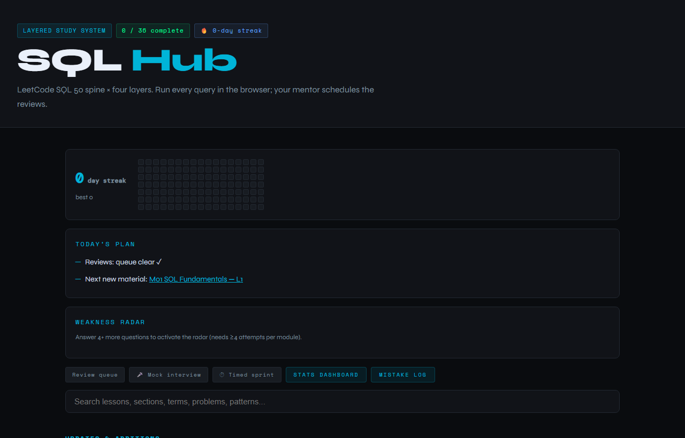
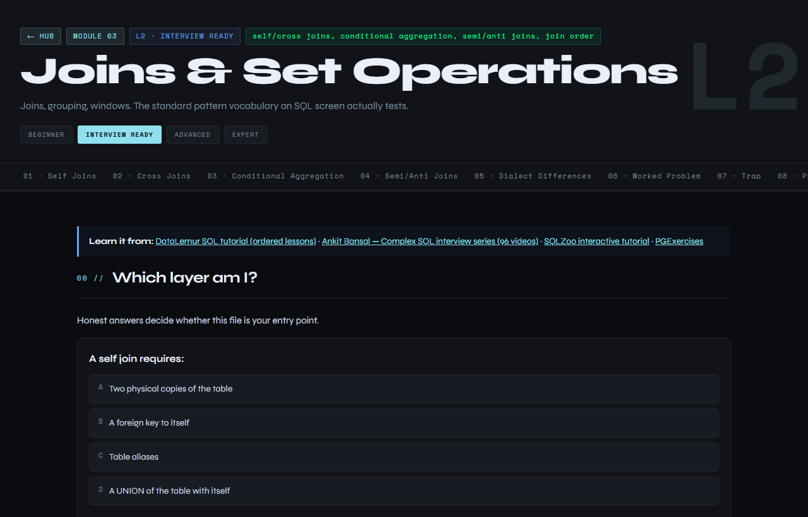
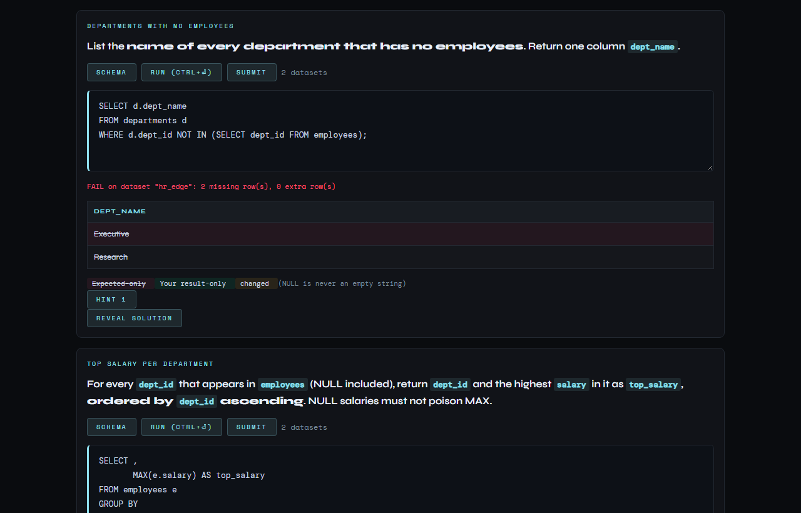
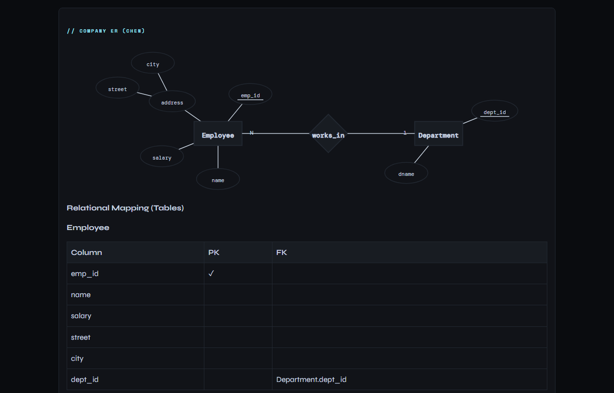

# SQL Layered Study System

[](https://github.com/INEEDTHATGT3/SQL-LMS/actions/workflows/ci.yml)
[](LICENSE)
[](https://react.dev/)
[](https://vitejs.dev/)
[](https://pglite.dev/)

A self-paced SQL curriculum delivered as a single-page React app: 9 modules, each written at four difficulty tiers, so the same topic can be studied as a zero-assumption primer or as plan-level optimization material. Every exercise runs on a real PostgreSQL engine inside the browser and is graded against hidden edge-case data. Sibling project to [dsa-lms](https://github.com/INEEDTHATGT3/dsa-lms).

**Live app:** https://ineedthatgt3.github.io/SQL-LMS/

## Screenshots

| Module hub | Lesson view |
|---|---|
|  |  |
| **Graded SQL exercise:** the classic `NOT IN` + NULL trap passes the visible data and fails the hidden edge dataset, with a row diff | **ER diagram block:** Chen notation with composite attributes, plus the automatic ER-to-tables mapping |
|  |  |

## Features

- **9 modules × 4 tiers (36 lessons)**: every topic is written once per level instead of once overall, so a concept reads differently depending on what the learner is ready for.
- **Real PostgreSQL in the browser**: [PGlite](https://pglite.dev/) (Postgres compiled to WASM) loads on the first Run. Submissions are checked against a visible dataset and a hidden `_edge` twin (NULLs, duplicates, ties, empty groups), using a NULL-aware multiset compare and a row-level diff of what is missing or extra.
- **Striver-style approach ladder**: worked problems go Brute → Better → Optimal, each with code (PostgreSQL, MySQL, pandas), cost, pitfalls and a dry run. Every approach is executed in CI and must agree with the reference solution.
- **SQL dry runs**: `query-trace` shows the intermediate table after each clause (FROM → WHERE → GROUP BY → HAVING → SELECT → ORDER BY), `query-plan` renders EXPLAIN trees, and `dialect-diff` puts PostgreSQL, MySQL, pandas and SQLAlchemy side by side.
- **Blocks for theory and diagrams** (shared with the upcoming DBMS track): ER diagrams (Chen and crow's foot, ER → tables), functional-dependency stepper (closure, candidate keys, minimal cover), normalization decomposition, and a transaction-schedule analyzer (conflict/view serializability, recoverability, 2PL and timestamp protocols).
- **Active recall**: flashcards, misconception polls, predict-before-reveal and explain-back prompts, plus MCQ/MSQ/numeric/order/match questions with options shuffled per question.
- **Sourced problem bank**: 170 problems mapped from LeetCode SQL 50, HackerRank, LeetCode Advanced SQL 50 and PGExercises, each with a verifiable link. A provenance gate rejects invented ones.
- **Spaced-repetition review**: an SM-2-lite queue plus a mistake log; a wrong answer is enrolled for review automatically.
- **Mock interview, timed sprint, stats**: interview drills, a clock-driven sprint mode, a streak heatmap, a weakness radar and a progress dashboard.
- **Zero backend**: the app is fully static; progress, mistakes and streaks live in `localStorage`.

## Curriculum

Ordered per the **LeetCode SQL 50** study plan for modules 01–06; modules 07–09 are deliberate off-spine extensions for data-analyst and data-engineering roles. Every module is available at four tiers:

| Level | Name | Promise |
|---|---|---|
| 1 | Beginner | Core syntax and mental models. Tables as grids. One SELECT solves it. |
| 2 | Interview Ready | Joins, grouping, windows: the pattern vocabulary an SQL screen actually tests. |
| 3 | Advanced | CTEs, recursion, optimization, dialect differences. You justify the plan. |
| 4 | Expert | Execution plans, partitioning, stored procedures, triggers. Constraint-driven. |

<details>
<summary>All 9 modules</summary>

| # | Module | Focus | Learn it from |
|---|---|---|---|
| 01 | SQL Fundamentals | SELECT, types and casting, NULL / three-valued logic, WHERE, ORDER BY, LIMIT, DML and transactions | LeetCode SQL 50, SQLZoo, Gate Smashers SQL playlist, techTFQ |
| 02 | Filtering & Conditionals | IN, BETWEEN, LIKE, regex, CASE, NULL handling, evaluation order | LeetCode SQL 50, SQLZoo, DataLemur |
| 03 | Joins & Set Operations | INNER/LEFT/RIGHT/FULL, self-join, semi/anti joins, UNION, EXCEPT | DataLemur, Ankit Bansal, SQLZoo, PGExercises |
| 04 | Aggregation & Grouping | GROUP BY, HAVING, conditional aggregation, ROLLUP, CUBE, grouping sets | DataLemur, Ankit Bansal, PGExercises |
| 05 | Window Functions | ROW_NUMBER, RANK/DENSE_RANK, LAG/LEAD, frames, running totals | DataLemur, Ankit Bansal, modern-sql.com |
| 06 | Subqueries & CTEs | Correlated subqueries, recursive CTEs, materialization | DataLemur, techTFQ, PGExercises |
| 07 | Performance & Indexing | EXPLAIN, planner cost, indexes, statistics, storage internals | Use The Index, Luke; CMU 15-445 |
| 08 | Advanced Analytics | Metrics and grain, cohorts and funnels, time intelligence, pivots | Ankit Bansal, DataLemur, StrataScratch |
| 09 | Time-Series & Geospatial | Gap filling, interpolation, date arithmetic, PostGIS basics | PGExercises, modern-sql.com |

</details>

### Problem sourcing

SQL has no single Striver-equivalent sheet, so the curriculum uses a **spine plus overlays**. The rationale and precedence rules are in [`content/SOURCING.md`](content/SOURCING.md); the mapped bank is [`content/problems.json`](content/problems.json).

| Source | Role | Count | Access |
|---|---|---|---|
| [LeetCode SQL 50](https://leetcode.com/studyplan/top-sql-50/) | **Spine**: fixes the order and the L1/L2 boundary | 50 | Free |
| [HackerRank SQL](https://www.hackerrank.com/domains/sql) | Volume overlay (L1) | 58 | Free |
| [LeetCode Advanced SQL 50](https://leetcode.com/studyplan/premium-sql-50/) | L3/L4 spine extension | 50 | Premium |
| [PGExercises](https://pgexercises.com/) | Postgres-native practice (L2/L3) | 12 | Free |
| [DataLemur](https://datalemur.com/questions) · [StrataScratch](https://platform.stratascratch.com/coding) | Company realism (L3/L4) | — | Freemium |
| [Ankit Bansal](https://www.youtube.com/@ankitbansal6) · [techTFQ](https://www.youtube.com/@techTFQ) | Explanation reference | — | Free |

Every problem is either **sourced** (it carries `platform` + `ref` + `url`) or a **drill** (`"platform": "drill"`). There is no third kind.

## Tech stack

- [React 18](https://react.dev/) with [React Router 6](https://reactrouter.com/) (`HashRouter`, for GitHub Pages)
- [Vite 5](https://vitejs.dev/) for the dev server and production builds, with lazy-loaded block chunks
- [PGlite](https://pglite.dev/) in a Web Worker for in-browser PostgreSQL
- Pure-JS engines (`src/engines/`) for result comparison, schedules, FDs and ER mapping, each with `node:assert` self-tests
- [ESLint 9](https://eslint.org/) (flat config); GitHub Actions → GitHub Pages for CI/CD

## Getting started

Requires Node.js 20+.

```bash
npm install
npm run dev        # http://localhost:5173
```

Open `/#/lab` for a gallery of every block type with sample data.

### Checks

```bash
npm run lint             # ESLint
npm run test:engines     # engine self-tests
npm run check:exercises  # every solution and approach runs on its datasets (PGlite in Node)
npm run build            # sync problems + provenance + content lint + answer keys + vite build
```

## Project structure

```
content/            lessons (content/<module>/L1..L4.json), problems.json, datasets/*.sql, lab/*.json
src/lib/            progress store, SRS, grading, subject config
src/components/     core blocks + one lazy file per block type (src/components/blocks/)
src/engines/        pure logic + *.test.mjs
scripts/            content lint, provenance, exercise runner, answer-key generator
jobs/               job cards for the remaining build-out (see AGENTS.md)
docs/               teaching style guide, specs, research notes
```

The engine is subject-agnostic: everything SQL-specific lives in `content/subject.json` and `content/modules.json`, so the same code will power the DBMS track and a merged multi-subject app.

## Deployment

A push to `main` runs CI (lint, engine tests, exercise checks, plan-shape harness, build) and deploys `dist/` to GitHub Pages (`.github/workflows/ci.yml`).

Pages has to be pointed at Actions once: repo **Settings → Pages → Source: GitHub Actions**.

## Progress & data

Progress, mistakes, review cards and streaks are stored per device in `localStorage` under `sql_progress_v2`; progress from the old static site (`sql_lms_progress_v1`) is migrated on first load. Nothing is sent to a server, and clearing site data resets progress.

## Contributing

Bug reports and content corrections are welcome; see [CONTRIBUTING.md](CONTRIBUTING.md). This project follows a [Code of Conduct](CODE_OF_CONDUCT.md).

## License

[MIT](LICENSE) © 2026 Dhruv Jaiswal
