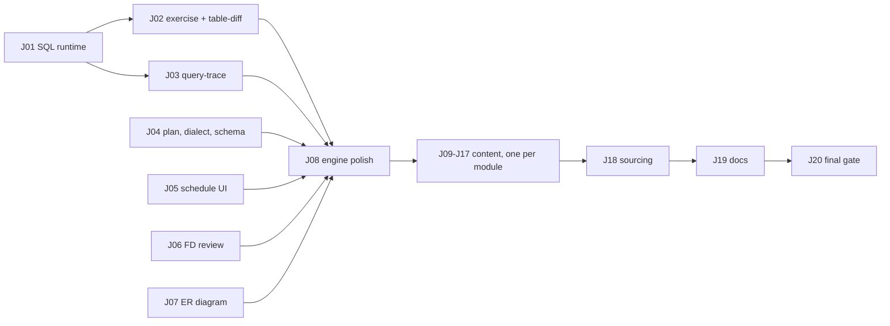

# SQL LMS — SPEC

> [!info] Brief
> **OBJECTIVE:** finish the SQL LMS React rebuild so it matches the DSA LMS, with runnable graded SQL and theory/diagram blocks.
> **DONE WHEN:** all blocks work in `/#/lab` · drills runnable where possible · audit errors fixed · build, `check:exercises`, `test:engines` green · Pages live.
> **FORMAT:** job cards for OpenCode in `JOBS/`, worked one at a time with `/job SQL Jnn` then `/inspect SQL Jnn`.
> **CAP:** each job ≤ 60 agent-minutes.

## 1 · Where things are
- Repo: `C:\MEGA NZ\SKILLS MATERIAL\sql-lms`, branch `spa-engine`. Rules for agents: its `AGENTS.md`. Block shapes: `content/BLOCKS.md`. Gallery: `npm run dev`, then `/#/lab`.
- Why this design (audit, sources, block research): `C:\Users\Dhruv\.claude\plans\improve-the-current-sql-atomic-moore.md`.
- Sourcing rules stay as before: `content/SOURCING.md`, `content/AGENT_BRIEF.md` invariants.

## 2 · Source stack
LeetCode SQL 50 fixes the order. HackerRank, SQLZoo and all PGExercises categories add L1–L2 reps. DataLemur, StrataScratch and LC Advanced SQL 50 add company realism. Explanation references per module live in `content/modules.json` → `refs` (DataLemur tutorial, Ankit Bansal's 96-video playlist, Gate Smashers SQL, techTFQ, Use The Index Luke, modern-sql).

## 3 · Job map

J04–J07 have no dependency on J01; they can run in any order. Content jobs J09–J17 can run in any order after J08. One OpenCode job at a time: J18 rewrites lesson files, so don't run it in parallel with content jobs.

## 4 · Content port rules (J09–J17)
For each lesson L1–L4 of the module:
1. Fix the audit errors listed in §5 for that module (line numbers are approximate).
2. Drop dialect fields that only say "same syntax"; keep real differences.
3. Turn drills into graded exercises where the datasets allow (`exercise: { datasets, solution }`, ≥ 3 per lesson, ids unchanged). Rewrite one-line drill statements into a full spec: input tables, expected columns, ordering.
4. Add one `query-trace` to L1 and to L2; add a `predict` or `misconception` for the module's classic trap (NULL in NOT IN, COUNT(*) vs COUNT(col), WHERE on the outer side of a LEFT JOIN…).
5. Rebalance MCQs so the correct option is not the uniquely longest.
6. Gates: `node scripts/lint-content.mjs --only=<module>`, `node scripts/check-exercises.mjs`, `node scripts/check-provenance.mjs`.

## 5 · Audit errors by module
- **basics:** L1 pagination OFFSET off by one (~:329); `manager_id` used (~:261, drill B106) but not in the lesson schema; placement Q4 asks WHERE vs HAVING before grouping is taught; "SELECT without FROM is valid" needs a dialect caveat (Oracle).
- **filtering, aggregation:** not read line by line in the audit; do a full correctness pass.
- **joins:** "FULL JOIN = LEFT UNION RIGHT" (L2 ~:406, ~:695) is wrong (use UNION ALL + anti filter); pandas "latest order" takes the earliest (L2 ~:155); "Merge Join is chosen when… All of the above" is ambiguous; MySQL semijoin nodes show only in `EXPLAIN FORMAT=TREE`; L2 says EXISTS and IN both stop at first match (~:259), contradicting subqueries L2; L4 PG11 parallel hash join described backwards (~:37, ~:208; PG11 introduced the shared hash table). Realign L2: join algorithms belong in L3; L2 must teach self/cross joins and conditional aggregation its problems need. LATERAL is duplicated in subqueries-ctes L2: keep it there, link from joins.
- **window-functions:** PostgreSQL has no IGNORE NULLS (L3 ~:272, ~:280); GROUPS frame is PG11+, not 14+ (L3 ~:653, L2 ~:238, ~:244); partition cardinality / "PARTITION BY reduces sort size" claims are wrong (L3 ~:32); work_mem is per sort/hash node, not per query (~:666); "RANGE frame ORDER BY must match index order" is meaningless; window functions do not run in parallel workers; W301/W302 contrived, W303 needs data. **Teach gaps-and-islands** (L2 intro, L3 full).
- **subqueries-ctes:** MySQL CTEs are not always materialized (L2 ~:230; MySQL 8 merges, MERGE/NO_MERGE hints); add PG14 SEARCH/CYCLE; placement Q4 wrongly says no max-recursion setting exists (MySQL `cte_max_recursion_depth`, SQL Server MAXRECURSION); same pandas latest-order bug.
- **performance:** PL/pgSQL examples don't compile (L4 `emp_lookup` ~:338 no DECLARE/BEGIN/END, unterminated `$$`; `settle_batch` ~:376 undefined `cur_rec`; `set_balance` no BEGIN/END); MySQL query cache was removed in 8.0, not deprecated; "SECURITY v/SQL SECURITY" typo; pandas `pre.compile`. Hand-made query plans must be real: capture `EXPLAIN (FORMAT JSON)` from PGlite on the datasets (joins L2 has a Hash node with no child; window L3 a CTE Scan with the CTE body as child).
- **advanced-analytics:** L2 Q (~:7) describes CUBE but keys GROUPING SETS; X203 (~:415) grand total is not 100% over a ROLLUP output (window sum includes subtotal rows: filter with GROUPING()); share formulas use integer division (cast to numeric); the funnel counts users who ever fired each event, not an ordered funnel; placement Q1 option "countiter" is garbage.
- **timeseries-geo:** `DATE_TRUNC` shown for MySQL (L1 ~:141); `ST_Segmentize` splits by max segment length, not speed (~:304); `ST_DWithin(…, 500)` on SRID 4326 means degrees (~:316), use geography; 3857 distances are inflated by 1/cos(lat), use geography or a local projection; nearest neighbour should use `ORDER BY geom <-> pt LIMIT k`; MySQL DATETIME is 5 bytes since 5.6.4. Re-scope L1 to dates, intervals and `generate_series` gap filling; move PostGIS/H3 to L4.

## 6 · Failure modes
- PGlite boot is ~3 MB: it must load only on the first Run click (lazy import + worker).
- A hidden `_edge` dataset must have the same schema as its base, or graded exercises fail for the wrong reason.
- Never change a problem id or tier during the port (learners' SOLVED state, curriculum spine).
